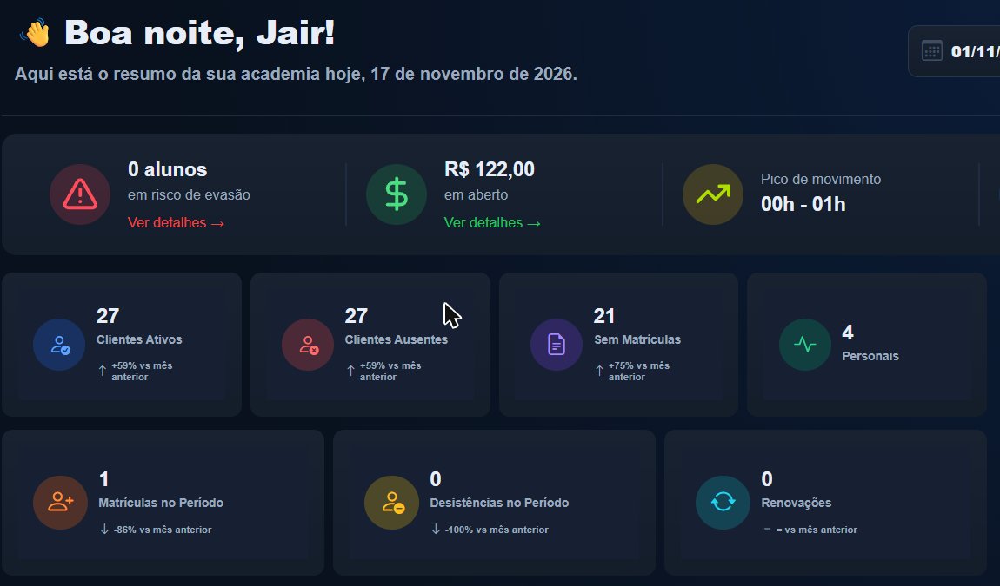
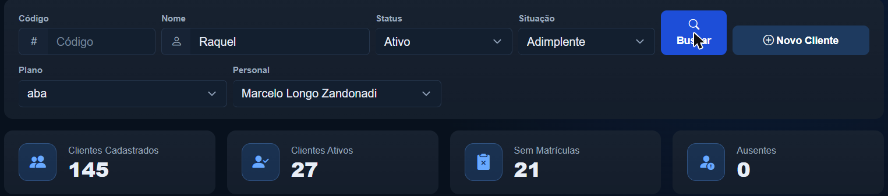
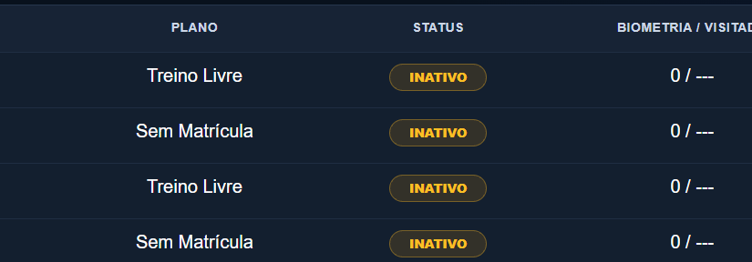

## Cenário de teste: Página Inicial. (RF04)

### Caso de Teste 01: Visualizar indicadores da Página Inicial.

| ID | Descrição |
| --- | --- |
| **C04-CT01** | O sistema deve exibir os indicadores após o login. |

| **Pré-condições** |
| --- |
| O usuário deve estar logado no sistema. |

| **Passos** |
| --- |
| **DADO** que o usuário realizou o login |
| **QUANDO** a Página Inicial for carregada |
| **ENTÃO** devem ser exibidos os cards de indicadores e a comparação com o mês anterior |

| **Critérios de aceitação** |
| --- |
| Todos os indicadores devem ser exibidos sem erros. |

| **Evidência** |
| --- |
|  [Vídeo](https://jam.dev/c/c54eab39-4f34-4cd6-89f6-14815b935de2)|
|  |

---

### Caso de Teste 02: Filtrar indicadores por período.

| ID | Descrição |
| --- | --- |
| **C04-CT02** | Os indicadores devem ser recalculados pelo período. |

| **Pré-condições** |
| --- |
| O usuário deve estar logado no sistema. |

| **Passos** |
| --- |
| **DADO** que o usuário está na Página Inicial |
| **E** seleciona o período de 01/09/2026 a 30/09/2026 |
| **QUANDO** clicar em "Buscar" |
| **ENTÃO** os indicadores devem ser atualizados para o período |

| **Critérios de aceitação** |
| --- |
| Os valores devem corresponder ao período filtrado. |

| **Evidência** |
| --- |
| [Vídeo](https://jam.dev/c/f7334652-27ab-4320-8818-db363019c86a)  |
|  |

---

### Caso de Teste 03: Visualizar gráficos de movimento.

| ID | Descrição |
| --- | --- |
| **C04-CT03** | O sistema deve exibir o movimento da academia. |

| **Pré-condições** |
| --- |
| O usuário deve estar logado no sistema. |

| **Passos** |
| --- |
| **DADO** que o usuário está na Página Inicial |
| **QUANDO** rolar até "Movimento da Academia" |
| **ENTÃO** devem ser exibidos os gráficos "Por Horário" e "Por Dia da Semana" |

| **Critérios de aceitação** |
| --- |
| Os gráficos devem ser carregados corretamente. |

| **Evidência** |
| --- |
|  [Vídeo](https://jam.dev/c/55149e7b-5dca-40a6-87ac-e10a3e415460) |
|  |

---

### Caso de Teste 04: Validar card de Clientes Ativos.

| ID | Descrição |
| --- | --- |
| **C04-CT04** | O número de Clientes Ativos deve bater com o cadastro. |

| **Pré-condições** |
| --- |
| O usuário deve estar logado no sistema. |

| **Passos** |
| --- |
| **DADO** que o usuário está na Página Inicial |
| **E** anota o número do card "Clientes Ativos" |
| **QUANDO** acessar "Clientes" e filtrar por status Ativo |
| **ENTÃO** a quantidade listada deve ser igual à do card |

| **Critérios de aceitação** |
| --- |
| O indicador deve refletir os dados reais. |

| **Evidência** |
| --- |
|   [Vídeo](https://jam.dev/c/2f20321c-b8b2-49a4-972b-1be774ce4746) |
|  |
|  |
