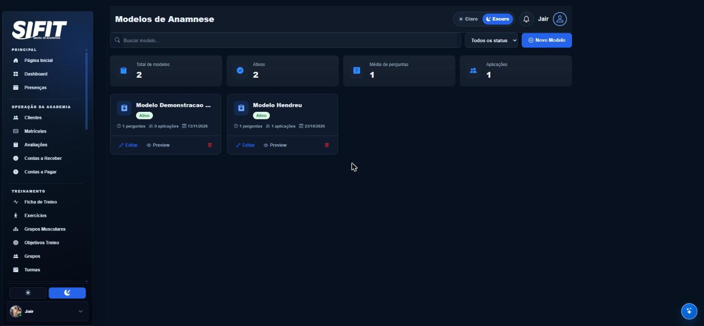
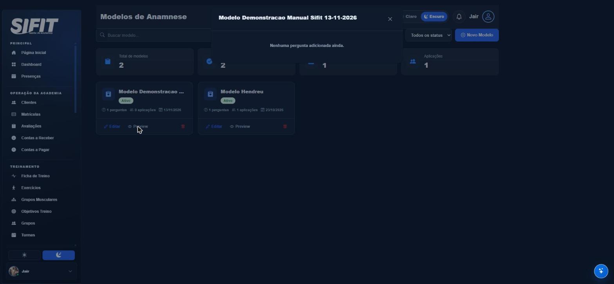
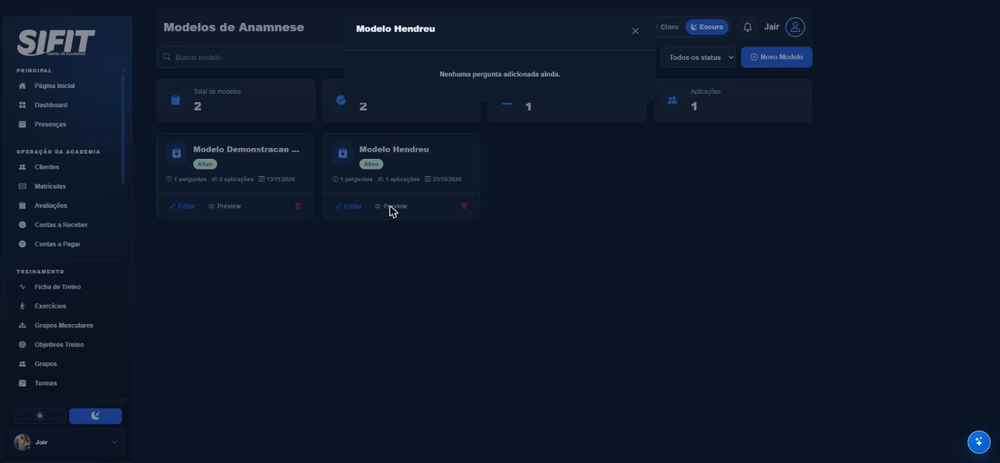
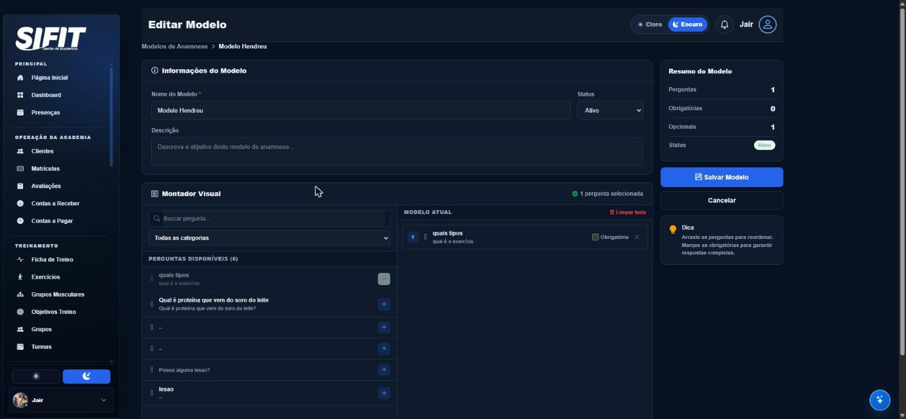

## Cenário de teste: Modelos de Anamnese. (RF42)

### Caso de Teste 01: Listar modelos.

| ID | Descrição |
| --- | --- |
| **C41-CT01** | O sistema deve listar os modelos. |

| **Pré-condições** |
| --- |
| O usuário deve estar logado no sistema. |

| **Passos** |
| --- |
| **DADO** que o usuário acessa "Modelos" em Saúde |
| **QUANDO** a tela carregar |
| **ENTÃO** devem aparecer os modelos |

| **Critérios de aceitação** |
| --- |
| A lista deve carregar sem erros. |

| **Evidência** |
| --- |
|  |

---

### Caso de Teste 02: Pré-visualizar modelo.

| ID | Descrição |
| --- | --- |
| **C41-CT02** | O sistema deve mostrar a prévia. |

| **Pré-condições** |
| --- |
| Deve existir modelo. |

| **Passos** |
| --- |
| **DADO** que o usuário está em "Modelos de Anamnese" |
| **QUANDO** clicar em "Preview" |
| **ENTÃO** deve aparecer a prévia com as perguntas |

| **Critérios de aceitação** |
| --- |
| Todas as perguntas devem aparecer. |

| **Evidência** |
| --- |
|  |
|  |
|  |

---

### Caso de Teste 03: Usar modelo na anamnese.

| ID | Descrição |
| --- | --- |
| **C41-CT03** | O modelo deve ser usado na ficha. |

| **Pré-condições** |
| --- |
| Deve existir modelo. |

| **Passos** |
| --- |
| **DADO** que o usuário cria uma anamnese |
| **QUANDO** selecionar o modelo |
| **ENTÃO** as perguntas do modelo devem ser carregadas |

| **Critérios de aceitação** |
| --- |
| As perguntas devem ser as do modelo. |

| **Evidência** |
| --- |
|  |
